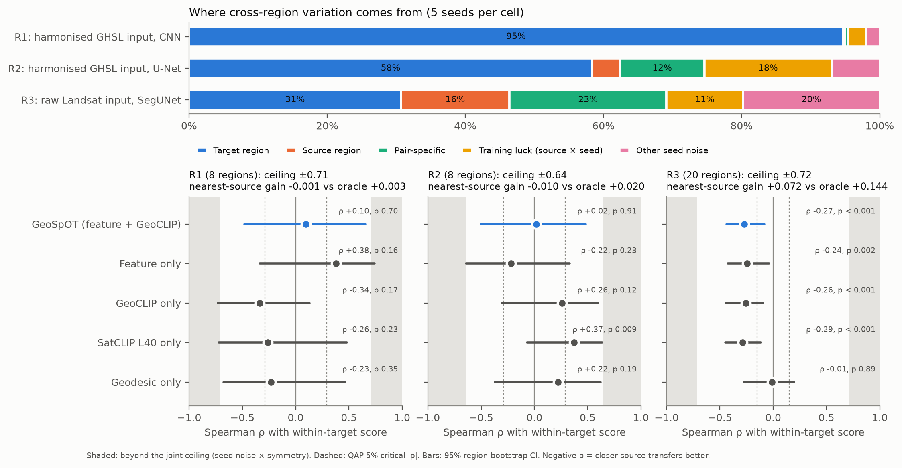

# geospot-urban-transfer

[](https://github.com/rohanbalixz/geospot-urban-transfer/actions/workflows/ci.yml)
[](LICENSE)

**How much of cross-region transfer can a distance between regions predict, and how much
of that does GeoSpOT capture?** This is a pre-registered test on dense urban-change transfer
matrices (8 and 20 world regions, 5 training seeds each).

GeoSpOT ([Zhang, Betti, Klemmer, Rolf & Alvarez-Melis, 2026](https://arxiv.org/abs/2604.16220))
predicts the accuracy drop between geographic domains from an optimal-transport distance
over image features and location embeddings. Its paper evaluates classification and lists
other tasks as open. This repo tests it on a dense prediction task. First it measures how
much of the transfer structure any distance could predict, then where GeoSpOT falls inside
that limit.

The plan and analysis code were committed (`075e436`, 2026-11-14 16:42 EST) before any
distance between regions was computed. Everything that happened afterwards is in
[`DEVIATIONS.md`](DEVIATIONS.md).

## Findings

1. **Most of a transfer matrix is not something a distance can predict.** A distance is
   symmetric, noise-free and the same for every model. Transfer is none of those. From the
   matrices alone:
   - only 29-37% of the variance in the relative drop is symmetric;
   - training luck (source × seed) is 3-18% of the variance;
   - a CNN and a U-Net trained on the same inputs disagree about which source is best for a
     target (Spearman −0.41 after correcting for seed noise).
2. **On harmonised inputs, GeoSpOT finds nothing.** Even where the U-Net's pair structure
   is reproducible across seeds (reliability 0.84), GeoSpOT reaches ρ = +0.02 (exact QAP
   p = 0.91), 3% of the achievable ceiling. Choosing the GeoSpOT-nearest source does worse
   than choosing at random (−0.010 FoM, against +0.020 for a cross-seed oracle).
3. **On raw Landsat inputs, GeoSpOT works.** ρ = −0.27 (QAP p = 0.0006, Holm-adjusted
   0.0012, 95% CI −0.44 to −0.08), 38% of the ceiling. The nearest source recovers half of
   the best achievable gain from choosing a source: +0.072 IoU (CI +0.034 to +0.122)
   against +0.144.
4. **Learned location embeddings carry the signal; raw geography does not.** In R3,
   SatCLIP-L40 alone (ρ = −0.29) and GeoCLIP alone (−0.26) match features alone (−0.24).
   Geodesic distance gets −0.01. Directional coverage did not predict the asymmetric part of
   the drop (ρ = +0.20, p = 0.33).



## Primary results

Pre-registered primary outcome: the **within-target score**, meaning a foreign source's
score on a target minus the mean score of all foreign sources on that target. It removes
how hard the target is and never uses the target's own model.

| Regime | Input → model, metric | Regions × seeds | Joint ceiling | GeoSpOT ρ | QAP p (Holm) | Share of ceiling | Nearest-source gain vs oracle |
|---|---|---|---|---|---|---|---|
| R1 (negative control) | harmonised GHSL → CNN, FoM | 8 × 5 | 0.71 | +0.10 | 0.70 (exact) | 14% | −0.001 vs +0.003 |
| R2 | harmonised GHSL → U-Net, FoM | 8 × 5 | 0.64 | +0.02 | 0.91 (exact; Holm 0.91) | 3% | −0.010 vs +0.020 |
| R3 | raw Landsat → SegUNet, IoU | 20 × 5 | 0.72 | **−0.27** | **0.0006 (Holm 0.0012)** | 38% | **+0.072 vs +0.144** |

- **Joint ceiling:** √(5-seed reliability) × the best Spearman any symmetric predictor can
  reach. Negative ρ means a closer source transfers better.
- **R3 scoring:** on held-out test cities. 13 of 100 models were retrained under the
  pre-registered collapse rule. Dropping the one region that stayed collapsed gives
  ρ = −0.30, p = 0.0005.
- **Full tables** (Δ and pair-specific outcomes, 9 secondary distances, H3, H5):
  [`results/SUMMARY.md`](results/SUMMARY.md).

**A side result (not pre-registered).** Scoring R3's in-region cell on held-out cities
instead of on all tiles changes the raw-Landsat home-field gap from +0.187 to +0.112, and
retention from 0.59 to 0.71. The out-of-region score barely moves (0.274 vs 0.272). Part
of the published raw-input "drop" in the cross-region study was in-sample scoring
([`results/R3_sensitivity.json`](results/R3_sensitivity.json)).

## Verify in seconds, without data

```bash
python3 -m venv .venv && ./.venv/bin/pip install numpy scipy pot pytest
./.venv/bin/python -m pytest -q tests/      # method checks on synthetic inputs
./.venv/bin/python verify.py                # 20 checks re-derived from committed files
```

`verify.py` checks that the pre-registration was committed before every results file. It
also recomputes the reliability and ceilings from the transfer-matrix receipts, the primary
ρ and its QAP p-value from the committed distance matrices, the selection gains, and the
Holm adjustment.

## Reproduce everything

| Step | Command | Needs | Time (M3 Pro) |
|---|---|---|---|
| Environment | `make env` | Python 3.11+ | 5 min |
| Tile features, R1/R2 | `make features` | global GHSL R2023A rasters | 1 min |
| Location embeddings | `make embeddings` | downloads SatCLIP-ResNet50 checkpoints | 2 min |
| R3 inputs | `make external processed landsat` | about 4 GB from Planetary Computer, no account | 1-2 h |
| R3 matrix | `make r3-matrix` | Apple MPS or CUDA | 10 min |
| Analysis | `make analysis figure verify` | | 30 min |

Derived tile features and embeddings are committed in `data/features/`, so `make analysis`
reruns every distance and test without downloading imagery.

## Layout

```
PREREGISTRATION.md   the frozen plan (commit 075e436)
DEVIATIONS.md        everything after the freeze, including operational events
docs/DESIGN.md       why the ceilings, the outcomes and the inference are what they are
src/geotransfer/     decomposition, inference (QAP, bootstrap), selection, OT distances,
                     coverage, GHSL features, location embeddings, data rebuild
src/run_analysis.py  the pre-registered analysis; refuses to run before the plan is committed
results/             R1-R3 JSON, COMBINED.json, SUMMARY.md, figure, R3 sensitivity
pilot/               outcome-only pilots run before the freeze (no distances)
data/                transfer-matrix receipts, cities, derived features and embeddings
rerun/               R3 training script (drop-in for the cross-region repo)
tests/, verify.py    method checks and result re-derivation (run in CI)
```

## Limits

- One task family (built-up mapping and change), three regimes, 8 or 20 regions. No claim
  goes beyond these.
- R1 and R2 reuse published transfer matrices whose in-region cell was scored on all tiles.
  The primary outcome avoids that cell; the relative drop does not.
- R3 inputs were re-acquired, because the originals are gone. The rebuilt tile grid
  matches the original on 786 of 786 tiles where it can be checked, but Landsat scenes may
  differ from the first pull.
- GeoSpOT is run as specified in its released code (linear cost, ε = 0.01, cosine,
  SatCLIP-ResNet50), with a debiased divergence and a global cost scale as the primary
  variant. The released-code variant is reported alongside: it agrees in R3 (ρ = −0.21,
  p = 0.005), and in R1 and R2 neither variant is significant.

## Data and acknowledgements

GHSL R2023A (European Commission, JRC; CC BY 4.0). Landsat Collection 2 Level-2 (USGS),
via Microsoft Planetary Computer. GeoCLIP and SatCLIP location encoders (MIT). Training
code from [Cross-Region Source-Invariance in Earth Observation](https://github.com/rohanbalixz/Cross-Region-Source-Invariance-in-Earth-Observation)
(`649e9ad`). GeoSpOT reference implementation:
[haoranzhang7/GeoSpOT](https://github.com/haoranzhang7/GeoSpOT).

## Citation

See [`CITATION.cff`](CITATION.cff). Code is MIT-licensed ([`LICENSE`](LICENSE)); vendored
SatCLIP modules keep their MIT licence in `src/vendor/satclip_le/`.
